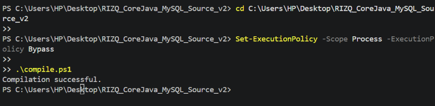
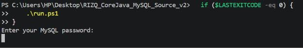
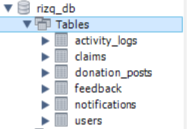
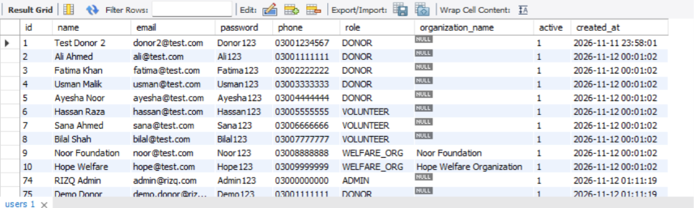

# RIZQ – Food Donation Platform

RIZQ is a Software Engineering project developed at **Sukkur IBA University** using Core Java and MySQL. The application supports food donation management through role-based access for donors, volunteers, welfare organizations, and administrators.

## Project Features

- User registration and login
- Donor dashboard
- Volunteer dashboard
- Welfare Organization dashboard
- Admin dashboard
- Food donation management
- Donation claiming and requests
- Feedback management
- Activity history

## Technologies Used

- Core Java
- MySQL
- JDBC
- MySQL Connector/J
- Windows PowerShell

## Data Structures

The project demonstrates the following custom data structures:

1. Singly Linked List
2. Doubly Linked List
3. Circular Linked List
4. Stack
5. Queue
6. Binary Search Tree

## System Requirements

- JDK 17 or later
- MySQL Server
- MySQL Workbench
- Windows PowerShell
- MySQL Connector/J: `mysql-connector-j-9.7.0.jar` (included in the `lib/` directory)

## Project Structure

```text
RIZQ-Food-Donation-Platform/
├── src/rizq/       # Java source code
├── database/       # Database SQL script(s)
├── lib/            # Required JAR libraries
├── docs/           # Project documentation
├── compile.ps1     # Compilation script
├── run.ps1         # Application execution script
└── README.md
```

## Database Setup

1. Install and start MySQL Server.
2. Open MySQL Workbench and connect to the local MySQL Server.
3. Open the SQL setup file available in the `database/` directory.
4. Execute the SQL script.
5. Ensure that the database is named `rizq_db`.

## Compilation and Execution

1. Open PowerShell in the project root directory.
2. Run the following command if script execution is restricted in the current session:

   ```powershell
   Set-ExecutionPolicy -Scope Process -ExecutionPolicy Bypass
   ```

3. Compile the application:

   ```powershell
   .\compile.ps1
   ```

4. After successful compilation, start the application:

   ```powershell
   .\run.ps1
   ```

5. Enter the password for the local MySQL account when prompted.

### Database Connection

The provided `run.ps1` script uses the following default connection settings:

- Database URL: `jdbc:mysql://localhost:3306/rizq_db?serverTimezone=UTC`
- Database username: `root`
- Database password: entered locally when prompted

If a different MySQL username is used, update the `$env:RIZQ_DB_USER` value in `run.ps1`. Database credentials should not be committed to the repository.

## Execution Evidence

### Java Compilation

*PowerShell output showing successful project compilation.*



### Application Execution

*PowerShell console showing the RIZQ application running and its main menu.*



## Database Evidence

### Database Schema

*MySQL Workbench showing the `rizq_db` schema and its tables.*



### Stored Application Records

*MySQL Workbench showing records stored in the project database, such as registered users and food donations.*



## Project Documentation

Project documentation and software testing documents are available in the `docs/` directory of the GitHub repository.

## Academic Information

- **Project Title:** RIZQ – Food Donation Platform
- **Institution:** Sukkur IBA University
- **Project Category:** Software Engineering Project
- **Development Model:** Waterfall

## Repository

[ RIZQ – Food Donation Platform on GitHub ](https://github.com/Fatima-Sardar/RIZQ-Food-Donation-Platform)
